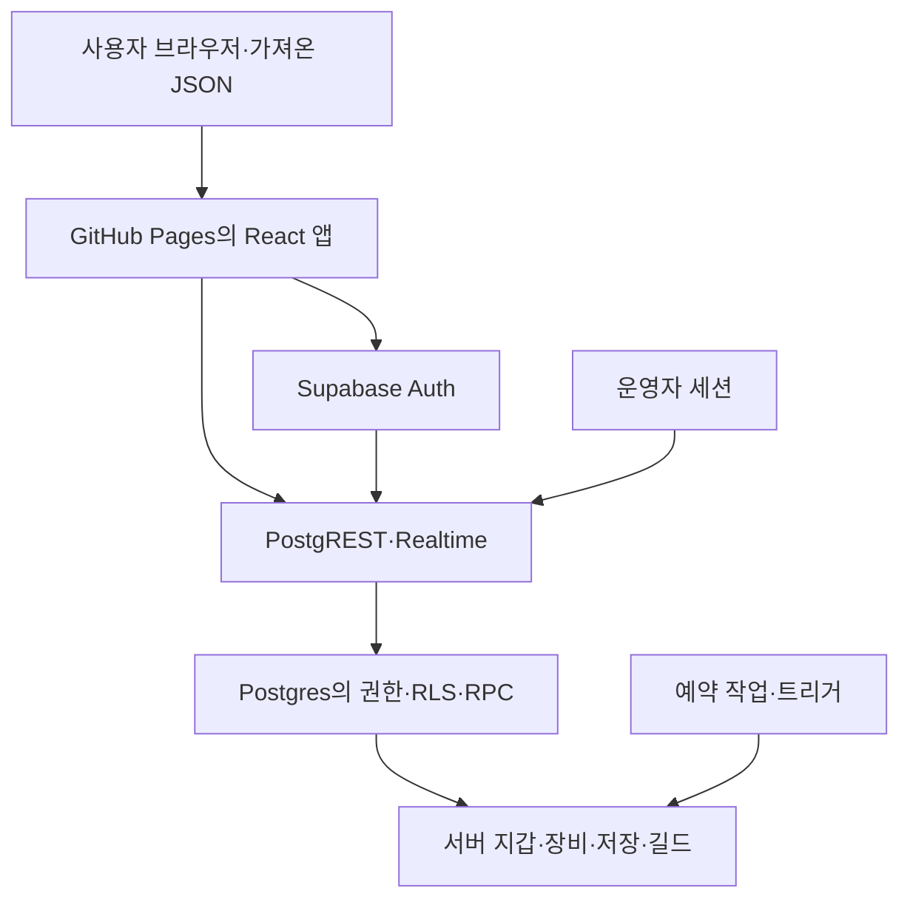

# 탑의 기록 — 전체 공격 경로와 신뢰 경계

작성일: 2026-10-20 KST. 소스 기준: `d4b88839612d3335e81f537c70c89ca41e9d7f6e`. 운영 DB 메타데이터·선택 함수는 같은 작업 중 읽기 전용으로 수집했다. 소스와 운영 서버가 하나의 원자적 스냅샷이라는 보장은 없다.

이 문서는 **취약점을 찾기 전 구조 파악 단계**의 결과다. 전체 진입점은 목록화했지만 모든 함수의 안전성을 검증한 것은 아니다. 취약점 판정·심각도·공격 재현·수정은 수행하지 않았다. 운영 데이터·권한·함수·배포 설정을 변경하지 않았다.

## 사용한 스킬과 방법

Trail of Bits [audit-context-building](https://github.com/trailofbits/skills/blob/5c99c03fb8a9ea568432ecbcba5d86e9f4ac2bf0/plugins/audit-context-building/skills/audit-context-building/SKILL.md)을 고정 커밋으로 읽었다. `ANALYSIS_FORMAT`, `DOMAIN_NOTES`, 함수 분석 예제를 함께 적용했다. 출처: Trail of Bits Skills, CC-BY-SA-4.0. 전역 설치나 제3자 실행 스크립트 실행은 하지 않았다.

스킬의 함수별 분석 위임 방식을 사용해 6개 핵심 함수를 각각 분석하고, 호출·피호출 관계와 미확인 전제를 합쳤다. Supabase 스킬로 실제 운영 함수·역할/열 권한·RLS·트리거를 대조했다. 명칭·UI 버튼 존재 여부만으로 권한을 판단하지 않았다.

## 범위와 실제 수집량

| 대상 | 확인한 범위 | 한계 |
|---|---|---|
| 운영 SQL 함수 | public 153개, private 227개 목록·서명·EXECUTE·정의 MD5 | 목록은 검증 완료 표시가 아님. 다른 시스템 스키마는 이 함수 목록 범위 밖 |
| public 역할 진입 | authenticated EXECUTE 145개, anon EXECUTE 0개 | 본문 업무 권한은 별도. API exposed-schema 설정과 JWT 검증 구현은 외부 경계 |
| 운영 관계 객체 | public/private/storage/realtime 138개, 그중 private 116개·public 4개 | 테이블 권한과 열 권한을 별도로 조회. RLS와 API 노출을 함께 보아야 함 |
| 정책·자동 처리 | 정책 8개, 비내부 트리거 28개, 활성 cron 6개 | 각 트리거/worker 본문 전체를 분석한 것은 아님 |
| Storage·Edge | 버킷 0개, 배포 Edge Function 0개 | 해당 시점 목록이며 향후 추가·외부 서비스는 포함하지 않음 |
| 소스 | src 263개 파일 AST, 네트워크 호출 위치 48개, 로컬 입력 관련 호출 위치 71개 | 호출 위치 수는 엔드포인트 수와 다름. 동적 호출·실제 런타임 도달성은 별도 |
| 소스↔운영 연결 | public 함수명 131개에 소스 문자열 연결, 22개는 해당 연결 없음 | 문자열 연결은 실행 증명이 아님. 운영자 API 16개는 이 src에서 호출 문자열 없음 |
| 상세 분석 | 핵심 함수 6개, 운영 함수 본문 스냅샷 39개 | 나머지는 진입점 목록화 또는 의존성 일부 추적 상태 |

전체 함수 목록은 [ENTRYPOINTS.md](ENTRYPOINTS.md), 기계 판독 근거는 [evidence](evidence), 함수별 기록은 [functions](functions)에 있다.

## 시스템과 신뢰 경계

- **브라우저 내부:** UI·localStorage·sessionStorage·기기 ID·저장 JSON·요청 UUID·클라이언트 hash는 사용자가 바꿀 수 있는 입력이다. 클라이언트 검사 통과가 서버 권한을 뜻하지 않는다(`src/online/cloudSave.ts:L36-L45,L72-L90`, `src/components/SaveManagement.tsx:L27`, `src/storage/repository.ts:L353` 이후).
- **인증 경계:** Google 복귀 URL에서 PKCE 거래 검증 후 Supabase Auth token/user 응답을 세션으로 저장한다. 실제 서명·provider·redirect 정책은 외부 서비스다([OAuth 분석](functions/completeGoogleOAuth.md)).
- **게임 세션 경계:** 일반 플레이 변경은 JWT 사용자와 실제 auth.sessions, 활성 lease·generation·auth session·device·client 바인딩을 연결한다. 적용 여부는 RPC별로 확인해야 한다(`evidence/live-functions/private.require_active_game_session.sql`; 저장은 별도 인라인 검사 `public.save_game_state.sql:L9-L15`).
- **경제 경계:** 클라이언트 명령/저장 입력에서 private 지갑·자산·영수증으로 넘어간다. public의 SECURITY DEFINER는 직접 테이블 접근이 없어도 변경할 수 있으므로 함수 본문이 권한 경계다([은행 분석](functions/server_bank_action.md), [저장 분석](functions/save_game_state.md)).
- **운영 경계:** 운영자 권한은 게임 길드장 역할과 다르다. 현재 helper는 auth.users의 app metadata `coupon_admin`을 확인한다(`private.assert_operations_admin.sql:L7-L9`, `public.is_coupon_admin.sql`). 부여·회수·콘솔 소스 위치는 미확인이다.
- **배포 경계:** GitHub push/workflow → npm 의존성 설치·검사 → Vite bundle → Pages artifact가 브라우저 실행 코드를 결정한다(`.github/workflows/deploy-pages.yml:L3-L7,L16-L49,L59-L76`). GitHub 계정 보호·실제 branch rules·repository secret 설정은 이번 수집 범위 밖이다.

## 경로별 지도

아래는 공격 성공 목록이 아니라, 공격자 통제 입력이 보호 대상까지 이어질 수 있는 **조사 경로**다.

| ID | 진입 → 보호 대상 | 확인한 관문 | 이어서 확인할 질문 |
|---|---|---|---|
| A01 | OAuth URL/state/code → 토큰 → 브라우저 세션 | 거래 선소모·경로/TTL/state·PKCE·/user 확인 | 운영 redirect allowlist·provider 설정·동일 origin 전체 스크립트 경계 |
| A02 | JWT/기기·client 입력 → 플레이 lease → 게임 mutation | 실제 Auth 세션·lease 5필드 바인딩 | API별 적용 누락 여부, logout/refresh/takeover 동시 흐름 |
| A03 | 가져온 JSON/localStorage → 최초 save → 시장 자산 | bootstrap·save trigger·최초 wallet import | equipmentItems를 포함한 초기 필드가 어떤 서버 검증을 거쳐 소유 자산이 되는가 |
| A04 | 오래된 save/revision → 소비 반영·서버 투영 → 최신 save | 계정 row lock·revision 비교·서버 hash·이력 | NULL baseRevision 의미, 투영되지 않는 필드의 하위 사용처, wallet 존재 전제 |
| A05 | map/UUID/스킬 설정 → hunt/원정 → 전투·보상·공헌도 | 서버 상태·요청 영수증·보상 계산·경제 투영 | 장비 통계 helper·모든 reward writer·영수증 보존·호출 빈도 정책 |
| A06 | 주문·취소·수령 UUID/가격/수량 → 예치·거래·반환 | 공개 RPC와 private 경제 테이블 경계, 기존 거래 점검 기록 | 기존 place_online_market_order와 v2 병존, 모든 lock/취소/반환 조합 |
| A07 | 은행 action/params → 개인·공동 예치/대출·담보 | 서버 잔액·이율·만기·소유권·request fingerprint | 모든 writer lock 순서, 클라이언트 오류별 pending ID 수명 |
| A08 | 협회/대상/경매 ID → 회원 권한·공동 재화·낙찰 | guild별 서버 조회·role/leader·receipt, 기존 phase8 근거 | 권한 위임·탈퇴와 진행 중 작업의 동시 의미; 세금/점령 연계 전체 |
| A09 | coupon/referral/quest/상점 ID → 우편·재화·성장 | 서버 catalog·수령 상태·소유권 등 기능별 관문 | 전체 성장·친구초대·퀘스트 경로의 세션·일회성·한도 일관성 |
| A10 | 채팅 body·닉네임·association ID → DB → 다른 브라우저 | 열 INSERT 권한·RLS·prepare trigger·UNIQUE·React 문자열 | 탈퇴/계정 전환 후 열린 구독의 서버 재평가, 공개 수신 범위 |
| A11 | WebSocket topic/token → broadcast/postgres_changes → UI 상태 | 게임 세션 topic은 사용자별 정책, market/stronghold 수신 정책 | public/private 채널 선택·token 갱신·재연결·권한 변경 시 실제 전달 |
| A12 | 운영자 RPC 인자 → 지급 우편·쿠폰·감사·플레이어 조회 | ops_grant_reward의 admin helper·유효 reward·actor/request 감사 | 나머지 ops 15개 본문, 운영 콘솔 소스·관리자 회수/MFA/세션 정책 |
| A13 | GitHub/의존성/build 입력 → 배포 bundle → 사용자 세션 | dependency/secret 검사·CodeQL·CSP 생성 | 실제 GitHub 보호·배포 권한·HTTP 응답 헤더·live bundle 일치 |
| A14 | 서버 시계·cron·trigger → 만기·보상·전쟁·ledger | 실제 활성 작업·트리거 목록 | 전체 worker/body/권한·호출자·오류/재실행·트랜잭션 결합 |

## 직접 REST·Realtime·배경 처리

- `game_saves`: authenticated SELECT와 본인 UID 정책, 직접 INSERT/UPDATE 열 권한 없음. 저장 변경은 RPC 경로다. `game_save_versions`는 직접 읽기·쓰기 권한이 없다(`table-inventory.json`, `policies.json`).
- `game_player_profiles`: 일부 열 SELECT/INSERT가 허용된다. 현재 정책은 비익명 사용자와 본인 INSERT를 구분한다. `game_chat_messages`도 일부 열 INSERT가 가능하므로 table-level write=false만으로 쓰기 불가라고 판단하면 안 된다(`table-inventory.json`, `src/online/playerProfiles.ts:L19-L36`).
- 채팅은 현재 Realtime publication에 포함된다. **game_saves는 현재 수집된 publication 목록에 없지만 클라이언트는 postgres_changes 구독을 요청한다**(`publications.json:L1-L7`, `src/online/cloudSync.ts:L97-L107`). 해당 경로의 실제 전달·다른 동기화 수단은 열린 질문이다.
- Storage 시스템 테이블의 ACL은 존재하지만 수집된 Storage 정책과 버킷은 없다. ACL만으로 익명 데이터 접근이 가능하다고 단정하지 않는다(`policies.json`, `storage-buckets.json`, `table-inventory.json`).
- 활성 cron은 은행 만기, 거래·우편 만료, 프리미엄 일일 처리, 시스템 모니터, 채팅 보존, 마을 전쟁 정산이다. 명령과 주기는 `cron.json`에 있다. 실행하거나 삭제 작업을 호출하지 않았다.
- wallet 변경은 운영 ledger trigger, save/장비/스킬 변경은 마을전 guard/snapshot trigger 등 다른 하위 처리를 동반한다. root 함수만 읽고 부수효과가 없다고 보지 않는다(`triggers.json`; [저장 기록](functions/save_game_state.md)).

## 다음 검증으로 넘길 열린 질문

이 순서는 시스템 연결상 먼저 닫아야 할 의존성 순서이며 위험도 등급이 아니다.

1. **최초 저장 → 자산 편입:** bootstrap은 여러 필드를 덮어쓰지만 `equipmentItems`는 이 덮어쓰기 목록에 없다(`private.server_bootstrap_payload.sql:L9-L29`). wallet 최초 동기화는 그 필드에서 자산을 만든다(`private.sync_market_economy_from_latest_save.sql:L27-L39`). 트리거를 포함한 전체 초기화·catalog/통계 소비 경로의 의미를 확인해야 한다. 현재는 입력 경로만 연결했으며 비정상 장비 수용·이득을 재현하지 않았다.
2. **저장 revision·필드 권위:** root의 baseRevision 비교는 저장 열 revision 제약과 구분해서 확인해야 한다(`public.save_game_state.sql:L18,L29`; `constraints.json`, `columns.json`). 서버 투영되지 않는 progression/설정 필드를 실제 전투·보상 함수가 어디까지 신뢰하는지 확인해야 한다.
3. **운영 API의 배포/권한 관리:** ops 16개가 운영 목록에 있고 이 src 문자열 연결은 없다. 외부 운영 콘솔·별도 배포 위치·권한 부여/회수 절차는 `nothing found`이다. 이 사실 자체를 미승인 API 또는 권한 우회라고 판정하지 않는다([운영 지급 분석](functions/ops_grant_reward.md)).
4. **Realtime·소속 변경:** 저장 publication의 소스/운영 차이, 협회 탈퇴 후 구독, reconnect/token rotation의 전달 결과를 실제 세션으로 확인해야 한다. 실제 계정·동시 부하 검증은 사용자 요청에 따라 계속 보류한다.
5. **분석 미완료 본문:** 점령·대전 22개, 성장/소셜·기타 27개 등 나머지 RPC와 미확보 의존 함수는 ENTRYPOINTS에 따라 후속 함수 분석 대상이다. 기존 phase1~8 수정·테스트 결과를 이번 전체 함수 분석의 대체 근거로 사용하지 않는다.

## 증거와 검증 범위

운영 조회는 카탈로그·정책·스키마·함수 정의·배경 작업 목록에 한정했다. 사용자 저장 내용·토큰·메시지 본문·운영 감사 행·개인정보를 수집하지 않았다. 외부 로그인, 계정 생성, 재화 지급, 공격 payload 전송, 부하 테스트, 권한 수정은 수행하지 않았다.

소스 inventory 스크립트는 오프라인 AST를 읽을 뿐 앱이나 API를 실행하지 않는다. `node audit-context/tools/collect-source-inventory.mjs <source-commit>`으로 다시 만들 수 있다. 이번 결과는 소스 위치·JSON 구문·행 수·함수 목록 일관성을 검증했다. 전체 게임 테스트를 새로 실행한 보안 검증 결과는 아니다.

운영 스냅샷의 `definition_md5`는 원본 정의를 구별하는 카탈로그 값이다. 파일 단위 SHA-256·수집 범위·도구 provenance는 [MANIFEST.json](MANIFEST.json)에 기록했다. 이 자료는 시점별 증거이며 운영 함수가 이후 바뀌면 재수집이 필요하다.
